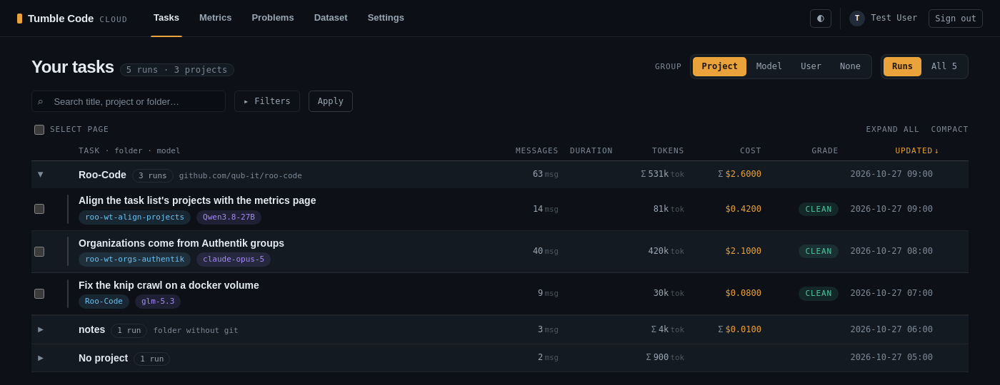

# Cloud web task list grouped by project, model or user (2026-10-26)

**Status:** implemented on `feat/cloud-web-task-groups`.
**Related plans:** `2026-09-23_cloud-web-subtask-tree.md` (the run tree the groups nest), `2026-10-02_*` daily
chart and pager (`_pager.html`, reused for group pages).
**Related plans (projects):** `2026-10-26_18-22_cross-session-recall.md` section 2 (what a project is), the
metrics page's grouping (`src/web/presenters/metrics_view.py`), which uses the same project.
**Touched:** `self-hosted-cloudapi/src/web/presenters/task_list.py`, `src/services/projects.py` (`visible_to`),
`src/routers/web_tasks.py`, `src/web/templates/tasks_list.html`, `src/web/static/app.css`,
`src/web/static/tasklist.js`, tests, `README.md`.

## Why

The owner asked for the task history in the cloud web panel to be aggregated: by workspace by default, and also by
the user who sent the request and by model. On the live deployment (2026-10-26) one user owns 1468 tasks across 24
workspaces and 22 model labels, so a flat list of 25 runs per page says little about where the work and the money
went.

The list shows the signed-in user's own tasks only (`Task.user_id == user_id` in every query). The owner chose to
keep that: grouping by user works within what the reader already sees, which is one group today.

## Behaviour

- `/app` gains a "Group" selector: Project (default), Model, User, None. "None" is the previous flat list. The value
  travels in the URL (`group=`) with the scope, filters and sort, like every other list state.
- Each group is a `
` header laid out on the row tracks, so its totals sit under the column labels: name,
  count, the project's key (project grouping: the repository, or "folder without git"), summed messages, tokens
  and cost, and the latest activity. Groups start closed; the browser reopens the ones the reader left open.
- An open group lists its first 5 tasks in the view's order, with the run tree under each run as before, and a
  "Show all N runs in X" link when it has more. The link sets `only=<key>`: the plain paged list of exactly that
  group, with a removable chip.
- Groups are ordered by the sorted column summed over the group (latest activity for "Updated"), 25 groups a page.
- A row shows the folder it ran in, also inside a project group, where the folders are the project's clones and
  worktrees. Inside a model group a row drops a single-model badge.
- Tasks without a project or a model form "No project" / "No model"; `only=(none)` selects them.
- The Project filter is a picker of the projects of the reader's tasks, by name; its value is the project id. The
  search box matches the title, the folder and the project's name.

## Design notes

- **Keys.** Project = `tasks.project_id`, the project entity of the metrics and projects pages
  (`models/project.py`, `services/projects.py`): every clone and worktree of one repository is one project, a
  folder without git is a project of its own, and a folder no client has reported yet has none. Keyed by id
  because two projects may share a name. Model = the first name of `tasks.models`, which lists the models
  most-used first; 16 of 1468 live tasks used more than one. User = `user_id`, named by the signed-in reader's
  e-mail (the only user the list can hold); any other id in `only` stays a bare id, so a hand-written URL cannot
  reveal another account's address.
- **Project names.** One query per page (`_reader_projects`) reads the projects of the reader's tasks that the
  reader may see (`services/projects.visible_to`: their personal projects and their organizations'); it names the
  groups, the chips and the picker's options. A task of an organization the reader has left keeps its project id,
  and its group is named by that bare id, so a foreign project's name never shows. A `project=` or `only=` value
  that is no project id (a folder path in an old link or remembered view) matches nothing: the empty state with its
  chip, not an error.
- **Aggregation in Python.** One narrow query reads id, keys and figures for every task the view matches, and the
  groups are summed in Python. The model key is the first element of a comma-joined label, which SQL would have to
  split per dialect (SQLite in tests, Postgres live). Then one query loads the shown rows and one `subtrees` call
  their trees.
- **Sums match the rows.** A group sums what its rows show. Under "Runs" a run's tokens and cost include its
  subtree (`_run_totals`) and its messages are its own; under "All" every task is a row and the group sums own
  figures, so no subtask is counted twice.
- **Exact narrowing.** `only` matches exactly: `project_id == key` (the Project filter uses the same match), and
  for a model `models == key OR models LIKE 'key, %'` (primary model only, so the count matches the group header).
- **Open/closed.** The three groupings are rows of the `GROUPINGS` table (label, empty name, key, column, match,
  display name), not branches.
- **Selection.** "Select page" and shift-click ranges skip rows inside closed groups, so a bulk delete never takes
  tasks the reader cannot see. "Expand all" opens groups and run trees together.

## Tests

See `tests/test_web_task_list.py` (filters and grouping sections): two worktrees of one repository are one group,
a folder project is its own group, "No project", the project filter and `only=` by id, a folder path from an old
link or remembered view matches nothing, and a project of an organization the reader is not in is named by its
id only. The flat-list tests request `group=none` explicitly; `test_route_table.py` lists the two query
parameters; `test_phone_layout.py` filters by a project id.

## Not done

- Grouping by user across users: needs a visibility model (admin role or organisation) the panel does not have.
- Personal and organization projects of one repository are two groups with one name; their keys are equal too.
  It takes a reader who works in both spaces; the projects page tells them apart by space.
- Case-variant model ids (`qwen3.8-27b` and `Qwen3.8-27B` both exist live) stay separate groups, as they are
  separate filter suggestions today.
