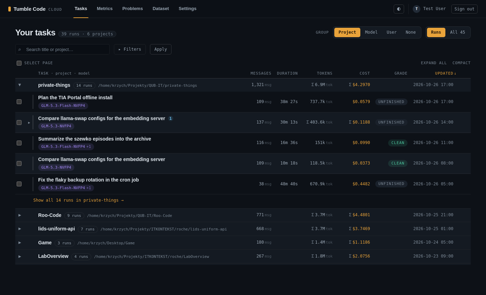

# Cloud web task list grouped by project, model or user (2026-10-26)

**Status:** implemented on `feat/cloud-web-task-groups`.
**Related plans:** `2026-09-23_cloud-web-subtask-tree.md` (the run tree the groups nest), `2026-10-02_*` daily
chart and pager (`_pager.html`, reused for group pages).
**Touched:** `self-hosted-cloudapi/src/web/presenters/task_list.py`, `src/routers/web_tasks.py`,
`src/web/templates/tasks_list.html`, `src/web/static/app.css`, `src/web/static/tasklist.js`, tests, `README.md`.

## Why

The owner asked for the task history in the cloud web panel to be aggregated: by workspace by default, and also by
the user who sent the request and by model. On the live deployment (2026-10-26) one user owns 1468 tasks across 24
workspaces and 22 model labels, so a flat list of 25 runs per page says little about where the work and the money
went.

The list shows the signed-in user's own tasks only (`Task.user_id == user_id` in every query). The owner chose to
keep that: grouping by user works within what the reader already sees, which is one group today.

## Behaviour

- `/app` gains a "Group" selector: Project (default), Model, User, None. "None" is the previous flat list. The value
  travels in the URL (`group=`) with the scope, filters and sort, like every other list state.
- Each group is a `
` header laid out on the row tracks, so its totals sit under the column labels: name,
  count, the full workspace path (project grouping), summed messages, tokens and cost, and the latest activity.
  The first group in the current sort starts open.
- An open group lists its first 5 tasks in the view's order, with the run tree under each run as before, and a
  "Show all N runs in X" link when it has more. The link sets `only=<key>`: the plain paged list of exactly that
  group, with a removable chip.
- Groups are ordered by the sorted column summed over the group (latest activity for "Updated"), 25 groups a page.
- A row inside a project group drops its project badge; inside a model group it drops a single-model badge.
- Tasks without a workspace or a model form "No project" / "No model"; `only=(none)` selects them.

## Design notes

- **Keys.** Project = `workspace_path` (full path, so sibling worktrees with one basename stay apart). Model = the
  first name of `tasks.models`, which lists the models most-used first; 16 of 1468 live tasks used more than one.
  User = `user_id`, named by the signed-in reader's e-mail (the only user the list can hold); any other id in
  `only` stays a bare id, so a hand-written URL cannot reveal another account's address.
- **Aggregation in Python.** One narrow query reads id, keys and figures for every task the view matches, and the
  groups are summed in Python. The model key is the first element of a comma-joined label, which SQL would have to
  split per dialect (SQLite in tests, Postgres live). Then one query loads the shown rows and one `subtrees` call
  their trees.
- **Sums match the rows.** A group sums what its rows show. Under "Runs" a run's tokens and cost include its
  subtree (`_run_totals`) and its messages are its own; under "All" every task is a row and the group sums own
  figures, so no subtask is counted twice.
- **Exact narrowing.** `only` matches exactly: `workspace_path == key` (the `project` filter's substring match
  would pull `.../LabOverview/lab-overview-cloud` into `.../LabOverview`), and for a model
  `models == key OR models LIKE 'key, %'` (primary model only, so the count matches the group header).
- **Open/closed.** The three groupings are rows of the `GROUPINGS` table (label, empty name, key, column, match,
  display name), not branches.
- **Selection.** "Select page" and shift-click ranges skip rows inside closed groups, so a bulk delete never takes
  tasks the reader cannot see. "Expand all" opens groups and run trees together.

## Tests

See `tests/test_web_task_list.py` (grouping section). The flat-list tests now request `group=none` explicitly;
`test_route_table.py` lists the two new query parameters.

## Not done

- Grouping by user across users: needs a visibility model (admin role or organisation) the panel does not have.
- Case-variant model ids (`qwen3.8-27b` and `Qwen3.8-27B` both exist live) stay separate groups, as they are
  separate filter suggestions today.
