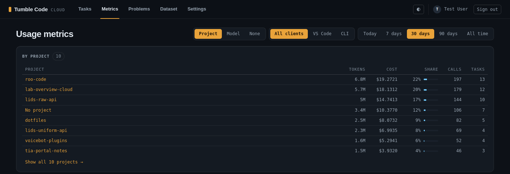
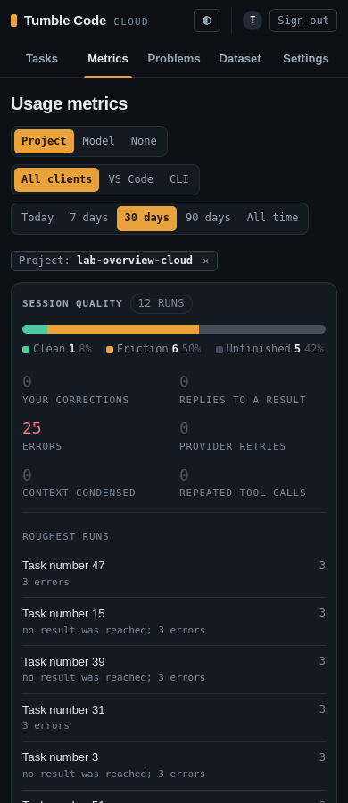

# Cloud web metrics grouped by project or model (2026-10-27)

**Status:** implemented on `feat/cloud-web-metrics-groups` (base `feat/recall-extension`).
**Related plans:** `2026-10-26_18-23_cloud-web-task-groups.md` (the task list's grouping this mirrors),
`2026-10-26_18-22_cross-session-recall.md` sections 1 and 2 (projects and `tasks.project_id`).
**Touched:** `self-hosted-cloudapi/src/services/metrics_service.py`, `src/services/quality_overview.py`,
`src/web/presenters/metrics_view.py` (new), `src/routers/web_metrics.py`, `src/web/templates/metrics.html`,
`src/web/static/app.css`, tests, `README.md`.

## Why

The owner asked for the metrics page to have the same aggregation as the task list. The page summed the reader's
whole usage over a period; it could not say which project or which model the money went to, nor show the charts
for one of them.

## Behaviour

- `/app/metrics` gains a "Group" selector next to the client and period selectors: Project (default), Model, None.
  There is no "User": the page always shows the signed-in reader's own usage (`TelemetryEvent.user_id == user_id`
  in every query), so it would be one group.
- With a grouping on, a "By project" (or "By model") table opens the page: one row per group with tokens, cost,
  share of the cost, calls and tasks, the costliest first. The first 8 rows show; "Show all N projects" lists the
  rest (`groups=all`, which, like `day_page`, rides only on its own link).
- A row's name links to `only=<key>`: the whole page is then that group's (stat tiles, daily chart and table,
  ranked charts, breakdown tables, session quality). A removable chip names the group; the table is hidden while
  narrowed, as the task list hides its group headers.
- The period, client, grouping and narrowed group ride on every link of the page (`MetricsView.url`).
- The picked grouping is remembered in a cookie (`tumble_metrics_group`), like the period, because the task list
  remembers its grouping too. `client` and `only` are not remembered.
- Phone (390 px): the selectors wrap, the table keeps name, tokens, cost and share; calls and tasks are on the
  group's own page.

## Design notes

- **Keys.** Project = `tasks.project_id` of the event's task, named by `projects.name`; keyed by id because two
  projects (a personal one and an organization's) may share a name. Model = the event's `modelId`. Events without
  a task row, without a project, or naming another user's task are in "No project" (`only=(none)`, the task list's
  `NO_KEY`); events without a model in "No model".
- **One query.** The completions query outer-joins `tasks` (on `id` and the reader's `user_id`, so another user's
  task id gives no project) and `projects`, both on primary keys. No lookup per event.
- **One aggregation.** `aggregate_user_metrics` stays the one pure pass: a `group_key` callable gives each event's
  (key, name); with `only` set, events of other groups are skipped before anything is counted, so every figure the
  page shows is the group's by construction. The groupings are a table (`metrics_view.GROUPINGS`): label, empty
  name, event key, and the `tasks` condition that narrows session quality.
- **Session quality** reads task rows, not events: narrowed by `tasks.project_id`, or for a model by the run's main
  model, reusing the task list's model match (`task_list.GROUPINGS["model"]`).
- **Indexing** (embedding events) carries no task, so it belongs to no group: the "Indexing" tile is left out while
  the page is narrowed.

## Timing

`/app/metrics?period=all` through the TestClient on SQLite, 40,000 completions, 1,500 tasks, 20 projects, median of
5 requests:

| View | Before | After |
| --- | --- | --- |
| No grouping | 474 ms | 513 ms |
| By project | (n/a) | 510 ms |
| By model | (n/a) | 527 ms |
| Narrowed to one project | (n/a) | 276 ms |

The 40 ms are the outer join; the rest is the unchanged Python pass. On Postgres the join is two primary-key
lookups per row.

## Tests

`tests/test_web_metrics_groups.py`: group sums equal the page totals (both groupings), the project of an event and
the "No project" group (no task row, no project, another user's task), `only=` narrows every figure to the group's
row and drops indexing, the chip and the narrowed session quality (project, `(none)`, model), every link keeps
period, client, grouping and `only`, an unknown `group` falls back to Project and a picked one is remembered,
`group=none` ignores `only`, and the 8-row limit with "Show all". Updated: the characterization golden (an empty
`groups` list), the columns the metrics query reads, the pager and period-cookie tests (links now carry `group=`),
`test_route_table.py` (`group`, `only`, `groups`), and `test_phone_layout.py` (the project and model tables, a chip
with a long model id; the hostile run now belongs to the long-named project).
