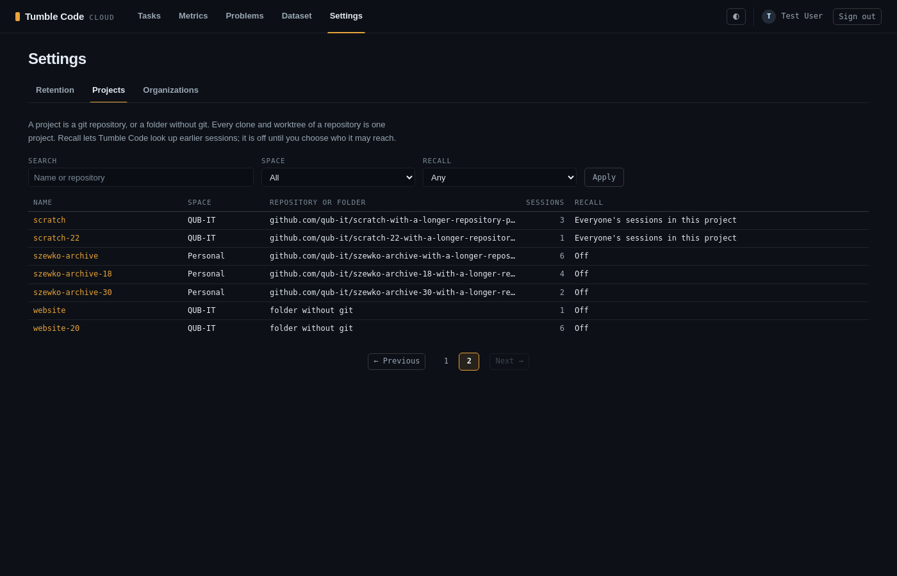

# Cloud web: Projects as a paged, filtered list with a page per project

**Status:** done on `feat/cloud-web-projects-list` (cut from `feat/cloud-web-settings-tabs`).
**Related plans:** `2026-10-27_10-03_cloud-web-settings-tabs.md` (tabs, breadcrumbs, `paginate`),
`2026-10-26_18-22_cross-session-recall.md` section 2 (projects, tenants, who manages what).
**Touched:** `self-hosted-cloudapi/src/services/projects.py`, `src/routers/web_projects.py`,
`src/models/project.py`, `src/web/templates/{projects,project_detail,_pager}.html`, `src/web/static/app.css`,
tests `test_projects.py`, `test_route_table.py`, `test_phone_layout.py`, `README.md`.

## Symptom

The owner, on the web panel (2026-10-27): Settings / Projects is one long column of blocks, each project with a
name field, a recall select, Save, a "merge into" select and Merge. With many projects that becomes unbearable. He
asked for a paged list, one row per project, with filters, and a click on a project opening its settings, with
breadcrumbs.

## Design

- **The list** (`/app/projects`): under the Settings heading and tabs, the lead paragraph about what a project is,
  a filter form and a table of 25 rows a page with the numbered pager. Columns: Name (a link to the project's
  page), Space (Personal or the organization's name, only when the reader belongs to an organization), Repository
  or folder (the key, `folder without git` for a folder key, cut with an ellipsis and whole in the hover title),
  Sessions, Recall (the scope's label). Sorted by name.
- **Filters**, all in the URL (`q`, `space`, `recall`, `page`), so a filtered page can be bookmarked and the pager
  keeps them: a text matched case-insensitively against name and key, Space (all, `personal` or an organization
  id), Recall (any, `off`, `on`). The form submits itself when a list changes (`data-autosubmit`, as on the
  problem report), with Apply for the text box and for pages without script.
- **SQL does the work.** `project_list_page` counts the matching projects, clamps the page with `paginate` and
  reads one page with limit and offset; each row's session count is a correlated count over `tasks.project_id`
  (indexed), so only 25 counts run. The tenants come from `spaces_for` (the personal space and each organization
  the reader is a member of), as `tenants_for` decided before; a `space` value that is not one of the reader's
  leaves no tenant and therefore no rows.
- **The project's page** (`/app/projects/{id}`): breadcrumbs Settings / Projects / name, the name as title, a meta
  line with the space, the key and the session count, then "Name and recall" (the form for whoever may manage it,
  the scope read-only for the rest, and the hint about the scope labels of its kind of space), the folders (with
  each member's e-mail in an organization) and, for a manager with other projects in the space, Merge.
  `project_access` decides who sees it: the owner of a personal project, any member of an organization's; admins
  manage. Unknown and foreign projects get the same `not_found_page`.
- **Merge by name.** A select of every other project does not scale, so the target is a text field with a
  `datalist` of the space's other project names. `merge_target` looks the name up case-insensitively among the
  source's space's other projects: none is `bad_merge` (which also covers a project of another space), two is a
  new `ambiguous_merge` ("rename one first"), because names are not unique: three people's folders without git
  named `notes` is exactly the case merging exists for. `merge_project` lost its own tenant check, which only
  `merge_target` can reach now.
- **Redirects.** Save returns to the project's page, Merge to the target's page; a refusal returns to the
  project's page with the error code in the query.
- **Pager labels.** `_pager.html` takes `prev_label` / `next_label` (default Newer / Older); a list sorted by name
  says Previous / Next.
- **Style.** The filter form is `.list-filter`, sharing the problem report's `.diag-filters` rule and its
  `.diag-field` fields; on a phone the table scrolls sideways in `.diag-table-wrap`. `table.diag-table th` now
  left-aligns every header that is not `.diag-num`: `table.breakdown`'s rule right-aligned columns 2 and later
  over it, so text headers sat right of their left-aligned cells on every `diag-table` page.
- `Project.key_label` is the one place that turns a folder key into `folder without git`.

## Tests

`test_projects.py`, through the pages:

- `test_the_list_filters_by_text_space_and_recall` (8 cases): no filter, text on the name (upper case), text on
  the key, each space, a space that is not the reader's, recall off, recall on with text; a colleague's personal
  project never shows; the Space column only with an organization and the empty state when nothing matches.
- `test_the_list_pages_by_25_and_keeps_its_filters`: 30 matching projects, page 1 and 2, a page past the end lands
  on the last, the pager link keeps `q`, no Space column without an organization.
- `test_a_member_views_and_an_admin_manages_an_organization_project`: the member sees the row, the read-only scope
  and the folder with its e-mail, and gets 404 on Save; the admin gets the form and is sent back to the page.
- `test_a_personal_project_refuses_what_it_does_not_offer` (2): the refusal lands on the project's page with its
  message.
- `test_merging_by_name_moves_folders_and_sessions`: the datalist offers the space's names only; `" NOTES "`
  merges into `notes` and lands on the target's page.
- `test_a_merge_target_is_one_project_of_the_same_space` (3): another space's name and an unknown name are
  `bad_merge`, two projects of that name are `ambiguous_merge`.
- `test_a_foreign_project_is_not_listed_and_answers_404` (2): someone else's personal project, an organization's
  project for an outsider: absent from the list, 404 on the page, on Save and on Merge.

`test_route_table.py` lists the new GET route; `test_phone_layout.py` adds `/app/projects/prj_long` (the
100-character name and the long key and folders).

Mutations, each turned a test red and was restored: the Space filter ignored, recall "on" inverted, no offset,
a non-member seeing an organization's project, the merge target looked up in every space, no ambiguity check, the
redirect after a merge pointing at the source, no `overflow-wrap` on the meta line and the folders (phone layout).
One mutation stays green on purpose: `icontains` replaced by `contains`, because SQLite's LIKE ignores ASCII case
anyway; PostgreSQL needs `icontains` (ILIKE).

## Notes

- The datalist carries every other name of the space. With thousands of projects in one organization it grows
  accordingly; a search endpoint would replace it then.
- No sort by sessions or last activity: the list sorts by name only.
