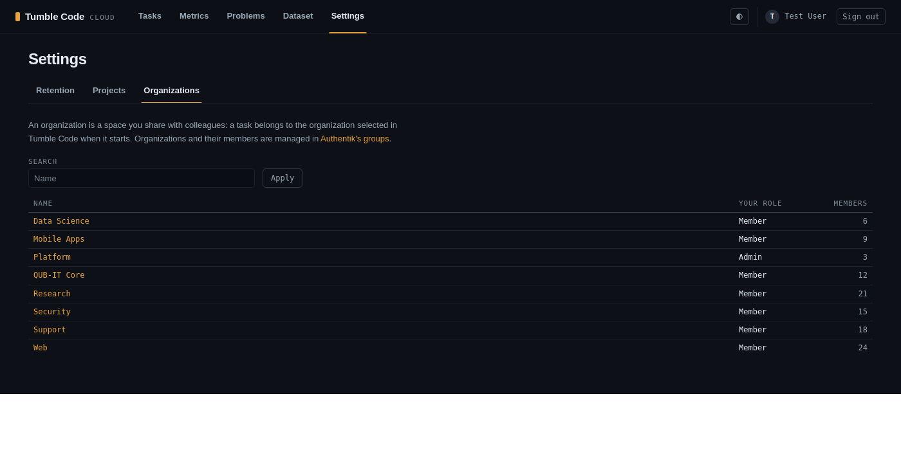

# Cloud organizations from Authentik groups (2026-10-27)

**Status:** implemented on `feat/cloud-orgs-from-authentik` (stacked on `feat/cloud-web-settings-tabs`).
**Related plans:** `2026-10-26_18-22_cross-session-recall.md` section 1 (tenants and organizations),
`2026-10-27_10-03_cloud-web-settings-tabs.md` (tabs, breadcrumbs, `paginate`).
**Touched:** `self-hosted-cloudapi/src/services/organizations.py`, `src/auth/authentik.py`, `config/auth.py`,
`config/settings.py`, `src/routers/browser.py`, `src/routers/web_organizations.py`, `src/main.py`, the two
organization templates, `_pager.html`, `app.css`, `authentik/blueprints/tumble-code.yaml`, `docker-compose.yml`,
`.env.example`, `README.md`, tests.

## Why

The owner chose (2026-10-27): organizations and memberships come from Authentik, synchronized at sign-in and
periodically through Authentik's API with a service token from `.env`, so removing someone works without waiting for
their next sign-in. The cloud page only shows organizations and links to Authentik's admin panel. The live database
had 0 organizations and 0 memberships, so nothing needed migrating.

## Behaviour

- A group with the attribute `tumble_organization: "<slug>"` is an organization: `organizations.slug` = the slug,
  `organizations.name` = the group's name (a rename in Authentik renames it here). Its direct, active members are
  `org:member`.
- A group with `tumble_organization_admins: "<slug>"` lists the admins (`org:admin`); an admin is a member even when
  not in the first group. An admins group whose slug has no organization group is ignored.
- People are matched by Authentik's user `uid` against `users.authentik_id`. A person who never signed in to the
  cloud has no row and is skipped; their first sign-in creates the row and syncs at once. A user deactivated in
  Authentik counts as no member.
- An organization whose groups vanished keeps its row (tasks and projects reference it) and loses every membership.
- The sync runs at startup, every 300 s (`SYNC_SECONDS`), and in the sign-in callback right after the user row is
  found or created (the web and the extension sign-in share `/auth/clerk/callback`). When Authentik's API fails
  (connection, 4xx/5xx, a non-JSON body) the sync logs a warning, keeps the memberships, and the sign-in goes on.
- `/app/organizations` (Settings tab): a paged table, one row per organization (name, your role, members), 25 to a
  page, filtered by name (`q`, case-insensitive substring). `/app/organizations/{id}`: breadcrumbs Settings /
  Organizations / name, your role, and a paged members table (admins first, then by e-mail). Both link to
  `{Authentik base}/if/admin/#/identity/groups`, the base taken from `front_channel`, so a browser that reached the
  panel through `WEB_PUBLIC_URL` gets an Authentik address it can open. Non-members get the shared 404.
- Gone: creating organizations, adding and removing members, changing roles, leaving, and their error messages.
  Project recall settings of an organization's projects stay editable by its admins.

## Design notes

- `services/organizations.reconcile_organizations(db, groups)` is one plain function: build the wanted state per
  slug from the groups, look up user ids by uid, create or rename organizations by slug, then per organization
  delete, re-role and add memberships. It manages every organization row; one without a slug (none exist outside
  tests) is "not in Authentik" and loses its members.
- `sync_organizations(db)` fetches, then reconciles and commits under a module `asyncio.Lock`, so the background
  loop and a sign-in never both insert the same organization or membership (the API runs one uvicorn process;
  `memberships` has no unique index on user and organization). The callback passes its own request session: the
  commit inside the lock also commits the new user row, which is what lets the sync see it.
- `src/auth/authentik.fetch_groups()` is the HTTP boundary: `GET {back channel}/api/v3/core/groups/?page=N&page_size=100`
  with `Authorization: Bearer AUTHENTIK_API_TOKEN` and the brand `Host` header of the other back-channel calls,
  following `pagination.next` until it is 0. All groups are read and filtered here rather than with Authentik's
  `attributes` filter, which matches exact values only.
- `AUTHENTIK_API_TOKEN` is required (settings, compose `:?`), checked like `SECRET_KEY` (no placeholder, 32+
  characters), because the blueprint provisions it into Authentik as a credential.
- Blueprint entry 5: role `Tumble Code cloud API` with `permissions: [authentik_core.view_group]`, user
  `tumble-code-cloudapi` of type `service_account` with that role, token `tumble-code-cloudapi-token` (`intent: api`,
  `expiring: false`, `key: !Env AUTHENTIK_API_TOKEN`), modelled on Authentik's own `system/bootstrap.yaml`.
- `_pager.html` takes `prev_label` / `next_label` (Previous / Next for lists sorted by name), the filter form uses
  `.list-filter`, and `table.diag-table th:not(.diag-num)` left-aligns the text headers (they sat right of their
  cells, under `table.breakdown th:nth-child(n + 2)`). All three are written exactly as on the projects-list lane, so
  the two branches converge when stacked.

## Authentik facts verified (Authentik 2026.8.3, the pinned image, read in the running container)

- `uid` = `sha256(f"{user.id}-{install id}")` (`authentik/core/models.py`, `User.uid`); under `sub_mode
  hashed_user_id` (the model default, and the live provider's value in `auth_db`) the ID token's and userinfo's
  `sub` is `user.uid` (`providers/oauth2/id_token.py` `_resolve_sub`, `views/userinfo.py`). Live: akadmin's `uid`
  prefix `787d86d70112` equals the cloud's `users.authentik_id`.
- Groups list: `users_obj` with `PartialUserSerializer` fields `pk, username, name, is_active, last_login, email,
  attributes, uid`, included unless `include_users=false`; members are the group's direct users
  (`core/api/groups.py`).
- Paging: `PageNumberPagination` with `page` and `page_size`, `pagination.next` = 0 on the last page, default size
  20, maximum 100 per tenant (`api/pagination.py`, `tenants/models.py`).
- API tokens: `Authorization: Bearer <key>`, only `intent=api` tokens, inactive users refused
  (`api/authentication.py`); a token with `expiring: false` never expires (`lib/models.py` `ExpiringModel`).
- Blueprints: `authentik_rbac.role` takes `permissions` as global permissions in blueprint context
  (`rbac/api/roles.py`); a user takes `roles` and `type`; a token takes `key` in blueprint context
  (`core/api/tokens.py`).
- The admin UI route `#/identity/groups` under `/if/admin/` exists (`/web/dist` route table).
- End to end, inside one transaction that was rolled back: the blueprint validated and applied; the token read
  `/api/v3/core/groups/` with 200 and every group's `attributes` and `users_obj` (uid, is_active); the same token
  got 403 on `/api/v3/core/users/`; a wrong token got 403; afterwards the service account did not exist.
  Side note: the role's `view_group` also grants Django's own `auth.view_group` (the serializer matches by codename),
  which nothing uses.

## Tests

- `tests/test_organizations.py` (12): the reconcile (new organization with members and admins, an admin outside the
  main group, a deactivated user and one who never signed in skipped; rename and member moves on the same row;
  vanished groups), the groups request (URL, page and size, Bearer token, brand Host, two pages), a first sign-in
  getting its membership at once, a failing Authentik (403, HTML, connection refused) leaving memberships and the
  sign-in intact, read-only pages with the Authentik link, 404 for outsiders, list paging and name filter, members
  paging with admins first. Only the network is replaced: conftest's autouse `authentik_groups` stands in for
  Authentik's answer, and the request and failure tests run the real `fetch_groups` over `httpx.MockTransport`.
- Mutations checked red: admin role, the active filter, the sign-in sync, catching a non-JSON body, rename, removal,
  the Authorization header, the name filter, admins first, own organizations only.
- `test_phone_layout.py`: the filtered empty list added to the organization pages already checked.
- Adjusted: route table, compose settings (`AUTHENTIK_API_TOKEN` required), placeholder-secret refusal, migration
  drift env, and the two callback fixtures that stand in for every DB call now stand in for the sync too.

## Rollout

The live `.env` needs `AUTHENTIK_API_TOKEN` before the next `docker compose up` (compose refuses to start without
it), then `docker compose up -d` so Authentik sees it and
`docker compose exec auth_worker ak apply_blueprint custom/tumble-code.yaml`.
