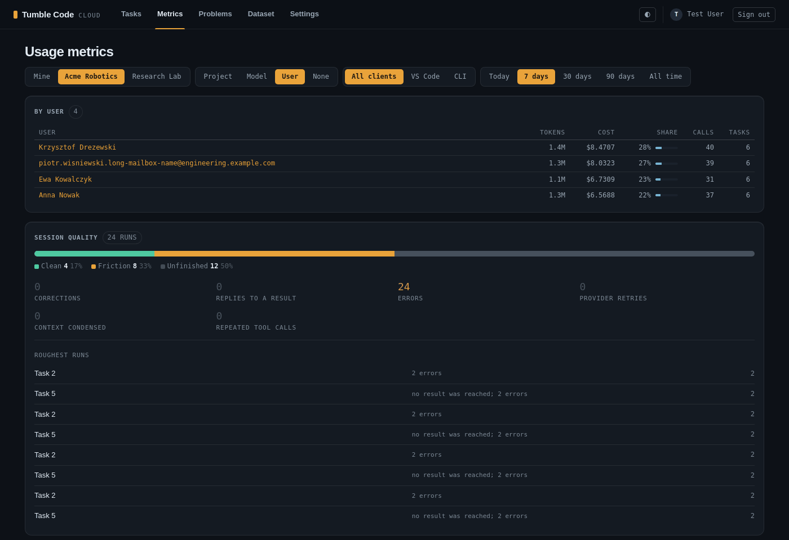
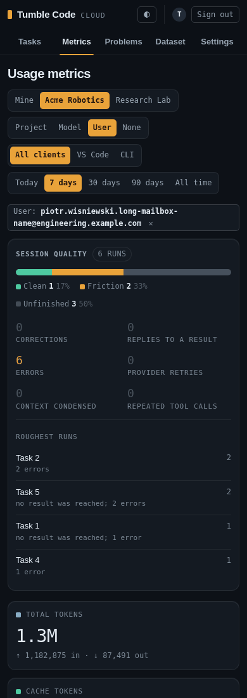

# Cloud web metrics of an organization, for its admins (2026-10-27)

**Status:** implemented on `feat/cloud-web-org-metrics` (base `feat/cloud-orgs-from-authentik`).
**Related plans:** `2026-10-27_10-00_cloud-web-metrics-groups.md` (the grouping this extends),
`2026-10-26_18-22_cross-session-recall.md` sections 1 and 2 (organizations, tenants, projects).
**Touched:** `self-hosted-cloudapi/src/services/metrics_service.py`, `src/services/quality_overview.py`,
`src/services/organizations.py`, `src/services/projects.py`, `src/web/presenters/metrics_view.py`,
`src/routers/web_metrics.py`, `src/web/templates/metrics.html`, `src/web/static/app.css`, `src/models/task.py`,
migration `alembic/versions/c3d4e5f6a7b9_tasks_organization_index.py`, tests, `README.md`.

## Why

The owner asked whether metrics should have a User grouping. On the reader's own page it would always be one group,
which is why the grouping lane left it out. Organizations now exist (synced from Authentik groups, roles `org:admin`
and `org:member`), and `tasks.organization_id` says which organization a task ran in, so an organization's usage
can be summed per member.

## Behaviour

- A "Space" selector opens the metrics page's controls, shown only to a reader who administers at least one
  organization: "Mine" (the default, the page as it was: the reader's own usage everywhere, their runs in an
  organization included) and one entry per organization they administer, by name.
- In an organization's space every figure covers the completions of that organization's tasks, whoever ran them:
  stat tiles, the daily chart and table, the ranked charts, the breakdown tables and session quality (the
  organization's top-level runs). The Indexing tile is left out: an embedding call belongs to no task, so to no
  organization.
- The Group selector there offers Project, Model, User and None. A user's group is named by their name, else their
  e-mail (members already see each other's e-mails on the organization page), and `only=<user id>` narrows the
  whole page to that member. On "Mine" there is no User option.
- Members who are not admins get no organization space: what each person costs is the admin's business. The
  selector is absent, and `space=` naming an organization the reader does not administer (or an unknown id) shows
  the reader's own page: no 404 and nothing of the organization's.
- `space=<organization id>` rides on every link of the page like `client`; the Space selector's links drop `only`
  (a member or project of one space means nothing in another). Like `client`, the space is not remembered in a
  cookie: a plain visit shows the reader's own usage, so nobody reads an organization's figures as their own. The
  remembered grouping still applies; a remembered "User" falls back to Project on the reader's own page.
- In the organization's space the "Roughest runs" are not links: a task page opens for its owner only. The
  corrections signal reads "Corrections" instead of "Your corrections".
- A project's name shows only when the reader may see the project (`services/projects.visible_to`, the task list's
  rule): a task in a project of an organization the reader has left stays in its own group, named by the bare
  project id, as on the task list. In an organization's space its admin sees its projects by name.

## Design notes

- **One query per space.** `compute_user_metrics(..., organization_id=)` builds the completions query either way:
  "Mine" is unchanged (the reader's events through the `(user_id, event_type, created_at)` index, their tasks outer
  joined for the project); an organization's joins the tasks with `tasks.organization_id` and the event's user equal
  to the task's owner, so an event someone else sent naming the task id does not count, and a task of another
  organization never does. `telemetry_events.organization_id` is not used: nothing writes it.
- **Who ran it.** The organization's query also selects the event's user and their name and e-mail (a primary-key
  join to `users`); the rows reach the groupings whole, so the User grouping reads them like the Project grouping
  reads the project. The groupings stay one table (`metrics_view.GROUPINGS`); `organization_only` keeps User off
  the reader's own page, and `group_options(in_organization)` builds the selector.
- **Session quality** takes the same `organization_id`: the organization's top-level runs instead of the reader's;
  narrowing to a user is `tasks.user_id`.
- **Who may.** `services/organizations.administered_organizations` lists the reader's `org:admin` memberships; the
  route keeps `space` only when it is one of them.
- **Index.** `tasks.organization_id` had none; `ix_tasks_organization_id` (model plus migration `c3d4e5f6a7b9`)
  serves the organization's tasks for the metrics query and session quality.

## Timing

`/app/metrics?period=all` through the TestClient on SQLite: 40,000 completions on 1,500 tasks of five people (the
reader 7,928 of them, the organization 19,947), median of 5 requests, several runs:

| View | Before | After |
| --- | --- | --- |
| Mine, no grouping | 100-102 ms | 104-113 ms |
| Mine, by project | 103-104 ms | 111-117 ms |
| Organization, by project | (n/a) | 310-375 ms |
| Organization, by user | (n/a) | 334-363 ms |
| Organization, one member | (n/a) | 202-266 ms |

The organization's page costs what the same number of completions costs on the reader's page (about 15 µs each,
the Python pass); the few ms on "Mine" are the admin lookup, the project visibility condition and reading the rows by column name.

`compute_user_metrics` on PostgreSQL 16.15: 200,000 completions, 6,000 tasks, 20 people, the organization 19,908
completions, `ANALYZE` run:

| Query | Without the index | With it |
| --- | --- | --- |
| Mine, all time (base commit: 153-166 ms) | 151 ms | 156 ms |
| Organization, all time | 426 ms | 483 ms |
| Organization, 7 days | 42 ms | 43 ms |
| Organization's session quality | 15 ms | 16 ms |

The SQL of the organization's 7-day query runs in 10-13 ms either way: Postgres walks the events through the
`(user_id, event_type, created_at)` index per person and hashes the organization's 600 tasks, which a sequential
scan of 6,000 rows finds in 0.6 ms. The index starts to matter when the tasks table grows to hundreds of thousands
of rows; until then the page time is the Python pass. The live deployment has 1,483 tasks, all without an
organization.

## Tests

`tests/test_web_metrics_groups.py`: the group sums equal the page totals and `only=` narrows every figure, both for
every grouping of each space (User only in the organization's); an organization counts every member's completions
on its tasks only (not another organization's task, not an outsider's event naming a member's task) and names a
member by name, else e-mail; an admin sees the Space selector, the User grouping, the organization's totals and
session quality, no Indexing tile, and links that keep `space=`; a plain member and an admin of another organization
get their own page for `space=` of this one (selector absent, or without it); a remembered User grouping falls back
to Project on the reader's own page; the chip of a narrowed member; a project the reader may not see is named by its
id. The characterization golden (`tests/fixtures/metrics_characterization.json`) is unchanged; the columns test
names the new labels. `test_route_table.py` lists `space`; `test_phone_layout.py` adds the organization's "By user"
table and a narrowed member with a long e-mail; the migration drift test covers the new index.

Mutation checks, each turned a test red and was restored: dropping the owner condition of the organization's join,
widening `administered_organizations` to every membership, session quality ignoring the organization, keeping
indexing in the organization's space, dropping `space` from the links, offering User on the reader's own page,
any organization's tasks instead of this one's, a member always named by e-mail, the project join without
`visible_to`, and an invisible project without a name.
