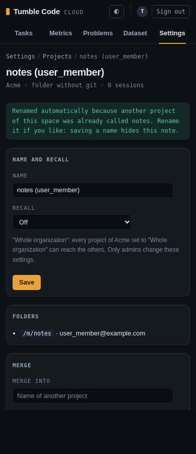

# Cloud project names unique in their space (2026-10-27)

**Status:** implemented on `feat/cloud-unique-project-names` (base `feat/cloud-orgs-from-authentik`).
**Related plans:** `2026-10-26_18-22_cross-session-recall.md` (section 2, projects and tenants),
`2026-10-27_10-13_cloud-web-projects-list.md` (the list, the project page and merging by name).
**Touched:** `self-hosted-cloudapi/src/models/project.py`, `src/services/projects.py`, `src/routers/web_projects.py`,
`src/web/templates/projects.html`, `src/web/templates/project_detail.html`, `src/web/static/app.css`, migration
`alembic/versions/d3e4f5a6b7c8_unique_project_names.py`, tests, `README.md`.

## Why

The owner decided: two projects of one name should not happen; when it would (the same path for several users),
raise an alarm and name the project differently. A folder without git is keyed per user
(`folder_key(user_id, path)`), so in an organization three members with a folder `notes` got three projects all
named `notes`, and merging by name had to refuse such a name as ambiguous. The live database (24 projects) had no
duplicate yet.

## Behaviour

- A project's name is unique in its tenant (an organization, or a user's personal space), case-insensitively. The
  database enforces it: unique index `uq_projects_tenant_name` on `(tenant_id, lower(name))`.
- A new project whose default name is taken gets the first free name of `name_candidates`:
  1. the default name (`notes`);
  2. the name qualified: for a folder without git by the local part of its user's e-mail (`notes (alice)`), for a
     repository by the owner segment of its key (`api (acme)` for `github.com/acme/api`);
  3. then numbered: `notes (alice, 2)`, `notes (alice, 3)`, ...

  Each candidate is cut so that it fits `NAME_MAX` (100) with its suffix.
- The alarm: the API logs a warning with the tenant, the wanted name, the new project's key and the name it got;
  the project keeps the wanted name in `projects.wanted_name`, and its page shows "Renamed automatically because
  another project of this space was already called X." (plus "Rename it if you like: saving a name hides this
  note." for whoever manages it). The Projects list says "N projects were renamed automatically ..." with a
  "Show them" link to the `renamed=1` filter.
- Saving the project's form (name and recall) clears `wanted_name`: the manager has seen the note and kept or
  changed the name.
- Renaming to a name another project of the space has is refused with `name_taken` ("Another project of this space
  already has that name. Choose another one."). The project's own name in other letter case is allowed.
- Merge by name: a name now finds at most one project, so the `ambiguous_merge` code, its message and its test are
  gone (no code for a state that cannot happen). Merging a project into its own name is `bad_merge`, as before.

## Design notes

- **Why this naming scheme.** The person (or repository owner) is what actually tells two `notes` apart for the
  people who see the list; it is stable (it does not depend on creation order beyond who came first) and readable.
  The repository owner is used for repositories because a repository project is shared by every member, so a
  person's name would suggest a private copy. The number only appears when one person has two folders of one name.
- **Races without a lock.** The file already handled concurrent creation with `INSERT ... ON CONFLICT DO NOTHING`
  and a read-back. The insert now has no conflict target, so it does nothing on either unique index (key or name)
  and returns no id (`RETURNING`); the loop then looks again: the project by key (another sign-in created it), else
  the next free name. On PostgreSQL the insert waits for the conflicting transaction, so the next look sees its
  row. Checked by hand on PostgreSQL 16 (throwaway container): 20 rounds of two users creating same-named folder
  projects at once, 20 retries taken, no error, every pair distinct.
- **The database compares names.** `_project_named` compares `lower(name)` in SQL, the same function the index
  uses; Python's `str.lower` differs from SQLite's ASCII-only `lower()`, and a mismatch would make the loop retry a
  name the index refuses forever.
- **The migration** (`d3e4f5a6b7c8`) adds `wanted_name`, renames every project after the oldest of a name in its
  tenant (by `created_at`, then id) to the first free `name_candidates`, records the old name in `wanted_name`, and
  creates the index. Its downgrade drops the index and the column and keeps the given names, which the older schema
  allows as well. Upgrade, downgrade and upgrade again also ran by hand on PostgreSQL 16, with a non-ASCII case
  pair (`Łódź`, `łÓDŹ`) renamed as PostgreSQL's `lower()` folds it.
- **Drift check.** SQLite's reflection skips an index on an expression (with a warning), so
  `test_migrations_reach_the_models` cannot see `uq_projects_tenant_name`; the migration test checks the index by
  inserting a duplicate. Listed in `tests/test_migration_drift.py`'s module docstring.
- `.notice` wraps long unbroken text (`overflow-wrap: anywhere`): the phone layout check caught the note quoting a
  100-character name.

## Tests

`tests/test_projects.py`:

- `test_a_taken_default_name_is_qualified_then_numbered`: three `notes` folders and two repositories named
  `Roo-Code` / `roo-code` in one organization, one more `notes` in a personal space; names, `wanted_name` and the
  warning line.
- `test_a_qualified_name_is_cut_to_fit`: a 100-character default name with each suffix stays at 100 characters.
- `test_a_name_taken_meanwhile_retries_with_the_next`: a `before_cursor_execute` hook inserts a competing `notes`
  just before our insert (the other sign-in won between our look-up and our insert); the project is created as
  `notes (user_member)` without an error.
- `test_a_renamed_project_says_so_until_a_name_is_saved`: the note for a member (without the rename hint) and an
  admin (with it), the list count and the `renamed=1` filter (with its hidden field), `" NOTES "` refused as
  `name_taken`, a name of another space accepted, the notes gone after saving, the own name in other case saved.
- `test_a_merge_target_is_another_project_of_the_same_space` (3): other space, unknown, the source itself.

`tests/test_migration_drift.py::test_duplicate_project_names_are_renamed_like_new_ones`: seven projects at the
previous head, including a case-only duplicate, an existing `notes (bob)` that forces a number, two repositories
named `api` with the same timestamp, and a personal `notes` left alone; then a duplicate insert hits the index.
`test_route_table.py` lists the `renamed` parameter; `test_phone_layout.py` gives `prj_long` a long `wanted_name`
and adds `/app/projects?renamed=1`.

Mutations, each turned a test red (or hung it, for the endless loop) and was restored: the insert's conflict target
back to `(tenant_id, key)` (IntegrityError in the race test), no `name_taken` check, `wanted_name` not cleared on
save, the suffix not counted in the cut, no number in later candidates (endless loop), the migration keeping the
newest instead of the oldest.

## Not done

- Two admins renaming two projects to the same name in the same instant: the second save fails on the unique index
  with a server error instead of `name_taken`. Not handled, as the window is a few milliseconds of two manual
  saves.
